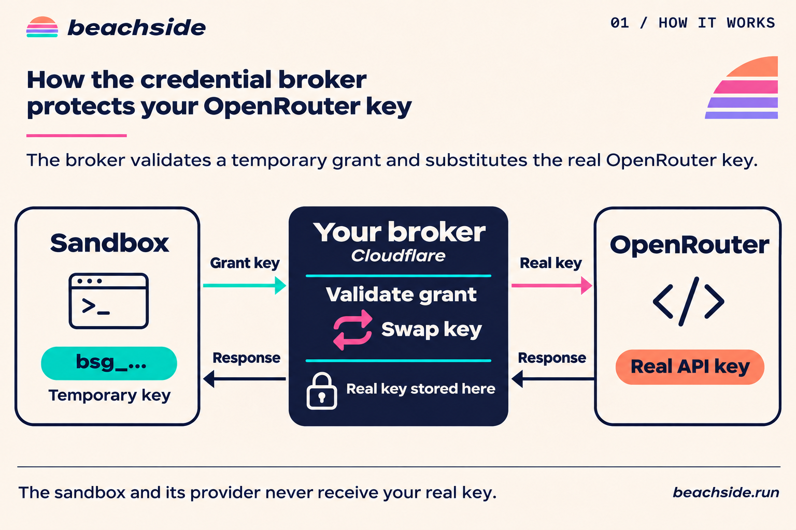
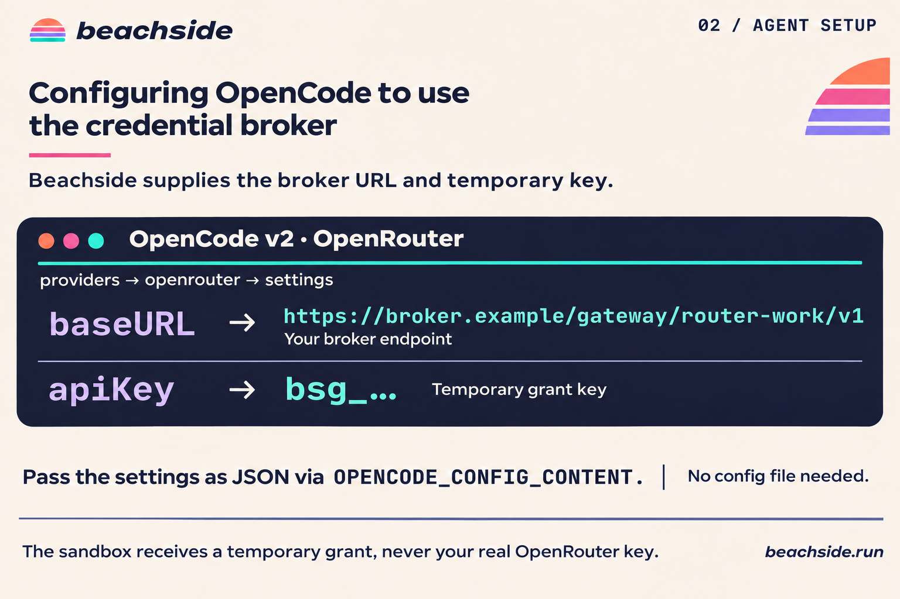

# Beachside credential broker

A self-hosted credential broker for AI sandboxes. The Worker stores encrypted upstream credentials and issues short-lived grants scoped to named integrations. The credential client and management CLI work with Beachside and standalone orchestrators.



## Deploy and configure

Use Bun 1.4.4 and Node.js 22 or later. From a clone of this repository, run:

```sh
bun install --frozen-lockfile
```

Set the Worker provisioning variables in the [deployment runbook](./services/credential-broker/README.md), then run `bun run deploy`. Use the Worker HTTPS origin in the client.

Build the CLI locally with `bun run build`. On the operator host, set `BEACHSIDE_BROKER_URL` and `BEACHSIDE_BROKER_ADMIN_KEY`. Pipe an upstream credential from a protected file or your secret manager:

```sh
node dist/cli.js integration create github-work --provider github --secret-stdin < /secure/path/github-token
node dist/cli.js issuer set github-work
node dist/cli.js integration list
```

The issuer allowlist starts empty. Setting it replaces the eligible integration set. CLI responses contain metadata. Keep the separate issuer key or GitHub Actions identity on the orchestrator.

### Rotate or invalidate access

Rotate an upstream credential while preserving its broker grants. Requests authorized after rotation use the replacement.

```sh
node dist/cli.js integration rotate github-work --secret-stdin < /secure/path/replacement-github-token
```

Disable the integration to revoke its broker grants. Re-enable it to allow fresh grants.

```sh
node dist/cli.js integration disable github-work
node dist/cli.js integration enable github-work
```

To remove the integration entirely:

```sh
node dist/cli.js integration delete github-work
```

Deleting an integration also revokes its grants and removes it from the issuer allowlist. Requests already authorized may finish. Broker revocation leaves the upstream token active at GitHub or its provider. See the [deployment runbook](./services/credential-broker/README.md#manage-integrations) for lifecycle and key-rotation details.

## Set up an HTTPS API

Run the interactive wizard from the operator terminal. It prompts for the integration credentials without echoing them.

```sh
node dist/cli.js integration setup
```

Choose OpenRouter, Kilo AI Gateway, Vercel AI Gateway, Cloudflare AI Gateway, OpenAI, Anthropic, or a custom HTTPS endpoint. Each setup fixes the upstream base URL and the headers the broker supplies. The Cloudflare preset asks for the gateway token and the upstream OpenAI key separately.

Review `integration show <id>`, then use `issuer set` with the existing allowlist plus the new integration ID. For automation, use `integration create <id> --provider http --config-stdin`. See [configurable HTTPS endpoints](./services/credential-broker/README.md#configurable-https-endpoints) for the JSON format and header rotation.

## Use the client

The root package exports `createCredentialBroker` and `createCredentialBrokerAdmin`. Call `broker.issue({ integrations, ttlSeconds })` and `broker.revoke(grant.id)` from a trusted host. Administration and grant-management calls have a 10-second budget that includes reading the response body. A timed-out write may have reached the broker. If a grant issuance response is lost, an issued grant remains until expiry or revocation. The issuer client can use a separate API key or [GitHub Actions OIDC](./services/credential-broker/README.md#authenticate-grant-issuance). The admin client manages integration and issuer policy metadata.

For Beachside integration, sandbox credential injection, GitHub CLI, OpenCode, and cleanup behavior, see the [Beachside credential broker guide](https://beachside.run/docs/guides/credential-broker/).

For a configurable HTTP integration, map its gateway URL and temporary grant to the environment variables your API client reads.

```ts
const credentials = broker.sandbox({
  endpoints: [
    {
      integration: "router-work",
      baseURLEnv: "OPENROUTER_BASE_URL",
      apiKeyEnv: "OPENROUTER_API_KEY",
    },
  ],
});
```

If `router-work` has upstream base URL `https://openrouter.ai/api/v1`, the sandbox base URL ends at `/gateway/router-work`. Set the client to use that URL as its API base.

For OpenCode v2, set the provider’s `baseURL` to the broker endpoint and its `apiKey` to the temporary grant. `OPENCODE_CONFIG_CONTENT` takes the nested JSON shown in the [OpenCode configuration example](./services/credential-broker/README.md#opencode).



The package will publish independently of the Beachside SDK as `@beachside/credential-client`. To try an unreleased revision, build it in a clone and run `npm pack`. Install the resulting tarball in the consuming project. It includes JavaScript, TypeScript declarations, and the `beachside-broker` executable.

## Validate a change

```sh
bun run check
bun run lint
bun run format:check
bun run test
bun run package:smoke
```

Tests use Git, GitHub CLI, OpenSSL, and local workerd fixtures. CI runs the checks without deployment credentials. The [release workflow](./docs/releasing.md) versions and publishes the public client independently of the Worker.
